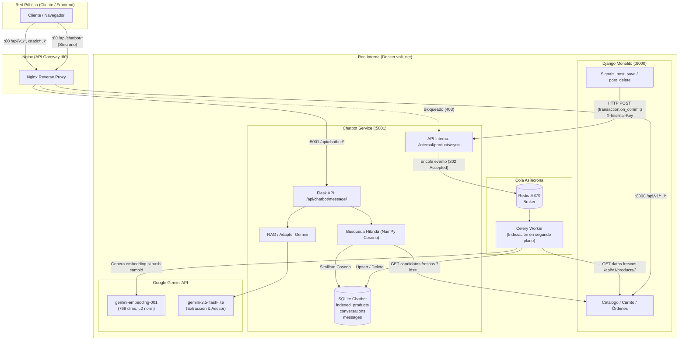

# Microservicio Chatbot de Volt (Asesor Virtual de Moda IA)

Documentación técnica y de operaciones para el microservicio de chatbot de la tienda virtual **Volt** (Arquitectura de Software 2026, Entrega 2).

---

## 1. Arquitectura y Responsabilidades

El proyecto implementa el patrón **Strangler Application** extrayendo la funcionalidad del asesor virtual de moda a un microservicio Flask independiente, conectado con el monolito Django a través de eventos HTTP y API REST, gobernado por **Nginx como API Gateway**.



### Separación de Responsabilidades:
- **Django (`monolito`):** Dueño único y fuente de verdad del catálogo (precios, stock, tallas, colores, categorías). Emite eventos mínimos asíncronos (`transaction.on_commit`) cuando un producto cambia y expone endpoints de lectura.
- **Flask (`chatbot_service`):** Gestiona la sesión anónima, el historial conversacional, la extracción de filtros mediante LLM, la búsqueda vectorial por coseno en NumPy y la redacción final con el patrón RAG.
- **Worker Celery + Redis:** Procesa en segundo plano la indexación de productos y el reindexado masivo con reintentos acotados (máx. 3 con backoff) y detección de cambios por hash SHA-256 (idempotencia).
- **SQLite propia de Flask (`/data/chatbot.sqlite3`):** Almacena vectores JSON de 768 dimensiones, hash de contenido, modelo, conversaciones y mensajes en modo WAL (`busy_timeout=5000`).
- **Nginx:** Punto único de entrada exterior (puerto 80). Enruta peticiones públicas y **bloquea tajantemente** cualquier acceso externo a `/internal/` (HTTP 403).

---

## 2. Endpoints y Contratos HTTP (JSON)

### 2.1 Público: Mensaje al Asesor Virtual
- **Ruta:** `POST /api/chatbot/message/`
- **Request:**
  ```json
  {
    "conversation_id": "opcional-uuid-o-string",
    "message": "Busco ropa deportiva azul para el calor, máximo 60 mil"
  }
  ```
- **Response (200 OK):**
  ```json
  {
    "conversation_id": "4c8f5e2b8a1c4327bb2f65a4e321d589",
    "session_id": "4c8f5e2b8a1c4327bb2f65a4e321d589",
    "reply": "Te recomiendo el Short deportivo azul [DEMO]. Está elaborado en poliéster de secado rápido, perfecto para entrenar en clima cálido por $49,900.00 COP.",
    "products": [
      {
        "id": 11,
        "name": "Short deportivo azul [DEMO]",
        "description": "Secado rápido para clima cálido.",
        "price": "49900.00",
        "stock": 20,
        "color": "azul",
        "material": "poliéster",
        "gender": "unisex",
        "available_sizes": ["M", "L"],
        "style": "deportivo",
        "category": {
          "id": 6,
          "name": "Ropa deportiva",
          "description": ""
        }
      }
    ]
  }
  ```
- **Códigos de Error:**
  - `400`: `{"error": {"code": "invalid_payload", "message": "El campo \"message\" es obligatorio..."}}`
  - `404`: `{"error": {"code": "conversation_not_found", "message": "La conversación indicada no existe."}}`
  - `502`: `{"error": {"code": "catalog_unavailable", "message": "No fue posible consultar el catálogo de productos en este momento."}}`
  - `503`: `{"error": {"code": "llm_unavailable", "message": "El asistente virtual no está disponible temporalmente. Intenta de nuevo en unos momentos."}}`

### 2.2 Público: Salud del Servicio
- **Ruta:** `GET /api/chatbot/health/`
- **Response (200 OK):**
  ```json
  {
    "service": "chatbot",
    "status": "ok"
  }
  ```

### 2.3 Interno: Sincronización de Catálogo (Django → Flask)
- **Ruta:** `POST /internal/products/sync`
- **Header requerido:** `X-Internal-Key: <INTERNAL_API_KEY>`
- **Request:**
  ```json
  {
    "product_id": 11,
    "event": "upserted"
  }
  ```
  *(o `event: "deleted"`)*
- **Response (202 Accepted):**
  ```json
  {
    "status": "queued",
    "product_id": 11,
    "event": "upserted"
  }
  ```

### 2.4 Interno: Disparo de Reindexación Completa
- **Ruta:** `POST /internal/reindex`
- **Header requerido:** `X-Internal-Key: <INTERNAL_API_KEY>`
- **Response (202 Accepted):** `{"status": "queued"}`

### 2.5 Catálogo Django (Consumido por Flask)
- `GET /api/v1/products/<id>/` → Retorna el producto con campos reales de moda y categoría anidada.
- `GET /api/v1/products/?ids=1,11,12` → Retorna lista filtrada de productos candidatos.
- `GET /api/v1/products/?limit=50&offset=0` → Retorna página ordenada por `id` para reindexación inicial.

---

## 3. Variables de Entorno

Definidas en `.env` (a partir de [.env.example](file:///c:/Users/sebas/Downloads/Arquitectura/Volt/.env.example)):

| Variable | Descripción | Valor por Defecto / Ejemplo |
|---|---|---|
| `NGINX_PORT` | Puerto público expuesto en el host | `80` (en EC2) o `8080` (local) |
| `POSTGRES_PASSWORD` | Contraseña de PostgreSQL en Docker | `volt-local-change-me` |
| `DJANGO_SECRET_KEY` | Llave secreta del monolito Django | `volt-local-development-change-me` |
| `DJANGO_DEBUG` | Modo depuración en Django | `False` |
| `DJANGO_ALLOWED_HOSTS` | Hosts permitidos | `localhost,127.0.0.1,django` |
| `NOTIFICATIONS_API_KEY`| Token para servicio de notificaciones | `volt-notifications-local-change-me` |
| `GEMINI_API_KEY` | Clave API de Google AI Studio | `AIzaSy...` |
| `GEMINI_EMBEDDING_MODEL` | Modelo para representación vectorial | `gemini-embedding-001` |
| `GEMINI_TEXT_MODEL` | Modelo para extracción y asesor RAG | `gemini-2.5-flash-lite` |
| `EMBEDDING_DIM` | Dimensión de vectores (768) | `768` |
| `SIMILARITY_THRESHOLD` | Umbral mínimo de similitud coseno | `0.55` |
| `TOP_K` | Cantidad de candidatos vectoriales a recuperar | `10` |
| `MAX_RESULTS` | Máximo de recomendaciones finales al usuario | `4` |
| `INTERNAL_API_KEY` | Llave compartida entre Django y Flask | `volt-chatbot-internal-secret-change-me` |
| `CHATBOT_INTERNAL_API_KEY` | Configuración idéntica en Django | `volt-chatbot-internal-secret-change-me` |
| `CHATBOT_SYNC_URL` | URL interna de eventos desde Django hacia Flask | `http://chatbot:5001/internal/products/sync` |
| `CHATBOT_SYNC_TIMEOUT` | Timeout en segundos de la señal Django | `2.0` |

---

## 4. Comandos de Operación

### 4.1 En Docker Compose (Despliegue Completo)
```powershell
# 1. Copiar y configurar variables
Copy-Item .env.example .env

# 2. Levantar todos los servicios en segundo plano
docker compose up -d --build

# 3. Ver estado de contenedores y healthchecks
docker compose ps

# 4. Ver logs del chatbot y worker Celery
docker compose logs -f chatbot celery-worker

# 5. Ejecutar la reindexación inicial del catálogo
docker compose exec django python manage.py sincronizar_chatbot --trigger-reindex

# 6. Detener los servicios
docker compose down
```

### 4.2 Pruebas Unitarias Automatizadas
```powershell
# Pruebas del microservicio Flask (64 tests con fakes y mocks, 0 llamadas a Gemini)
$env:PYTHONPATH="chatbot_service"
python -m unittest discover -s chatbot_service/tests -p "test_*.py" -v

# Pruebas del monolito Django (75 tests, señales y catálogo)
python manage.py test Volt
```

---

## 5. Pruebas Manuales con Postman o cURL

### 5.1 Health Check (a través del Gateway)
```bash
curl -X GET http://localhost/api/chatbot/health/
# Respuesta esperada: {"service": "chatbot", "status": "ok"}
```

### 5.2 Consulta Conversacional (Crear conversación)
```bash
curl -X POST http://localhost/api/chatbot/message/ \
  -H "Content-Type: application/json" \
  -d '{"message": "Hola, busco una camiseta fresca para hacer deporte"}'
```

### 5.3 Continuar Conversación con Filtro de Precio
```bash
curl -X POST http://localhost/api/chatbot/message/ \
  -H "Content-Type: application/json" \
  -d '{
    "conversation_id": "<conversation_id_obtenido>",
    "message": "Que sea de color azul y cueste menos de 50 mil pesos"
  }'
```

### 5.4 Comprobación de Seguridad de Endpoints Internos
```bash
curl -i -X POST http://localhost/internal/products/sync
# Respuesta esperada: HTTP/1.1 403 Forbidden (bloqueado por Nginx)
```

---

## 6. Despliegue en AWS EC2 (Paso a Paso)

1. **Instancia EC2:**
   - Crear una instancia Ubuntu 24.04 LTS (tipo recomendado: `t3.small` o `t3.medium` con 2 vCPU y 2-4 GB RAM).
   - **Security Group (Reglas de Entrada):**
     - Puerto `22` (SSH) desde tu IP.
     - Puerto `80` (HTTP) abierto a `0.0.0.0/0`.
     - *No abrir puertos 5000, 5001, 5432, 6379 ni 8000 (permanecen aislados en Docker).*

2. **Instalar Docker y Docker Compose:**
   ```bash
   sudo apt update && sudo apt upgrade -y
   sudo apt install -y ca-certificates curl gnupg
   sudo install -m 0755 -d /etc/apt/keyrings
   curl -fsSL https://download.docker.com/linux/ubuntu/gpg | sudo gpg --dearmor -o /etc/apt/keyrings/docker.gpg
   sudo chmod a+r /etc/apt/keyrings/docker.gpg
   echo "deb [arch=$(dpkg --print-architecture) signed-by=/etc/apt/keyrings/docker.gpg] https://download.docker.com/linux/ubuntu $(. /etc/os-release && echo "$VERSION_CODENAME") stable" | sudo tee /etc/apt/sources.list.d/docker.list > /dev/null
   sudo apt update
   sudo apt install -y docker-ce docker-ce-cli containerd.io docker-buildx-plugin docker-compose-plugin
   sudo usermod -aG docker $USER
   newgrp docker
   ```

3. **Clonar Repositorio y Configurar:**
   ```bash
   git clone <URL_DEL_REPOSITORIO_VOLT>
   cd Volt
   cp .env.example .env
   nano .env  # Pegar tu GEMINI_API_KEY real y cambiar contraseñas
   ```

4. **Levantar Stack y Poblar Datos:**
   ```bash
   docker compose up -d --build
   docker compose exec django python manage.py migrate
   docker compose exec django python manage.py cargar_demo
   docker compose exec django python manage.py sincronizar_chatbot --trigger-reindex
   ```

5. **Verificación:**
   - Abrir en el navegador: `http://<IP_PUBLICA_EC2>/` (Tienda Volt)
   - Probar endpoint: `http://<IP_PUBLICA_EC2>/api/chatbot/health/`

---

## 7. Cumplimiento de la Rúbrica de Arquitectura

| Criterio | Implementación en el Proyecto |
|---|---|
| **Microservicio Independiente** | `chatbot_service/` cuenta con proyecto Flask propio, `requirements.txt`, `Dockerfile`, base de datos SQLite aislada (`/data/chatbot.sqlite3`) y 0 importaciones de Django. |
| **API Gateway (Nginx)** | Único punto de entrada público expuesto (`:80`). Enruta `/api/chatbot/` a Flask, `/api/v1/` y `/` a Django, bloquea `/internal/` (403) y configura `proxy_read_timeout 30s`. |
| **Patrón Adapter** | Interfaces `EmbeddingProvider` y `TextGenerator` con adaptadores `GeminiEmbeddingAdapter` y `GeminiTextAdapter` y fakes desacoplados para pruebas sin llamadas externas. |
| **Redis + Celery** | Tareas asíncronas para indexación (`upsert_product_task`, `delete_product_task`, `reindex_catalog_task`) con idempotencia por hash SHA-256 y reintentos acotados (máx. 3). El chat se mantiene 100% síncrono. |
| **Docker Compose** | Archivo `docker-compose.yml` multi-contenedor (`db`, `redis`, `django`, `chatbot`, `celery-worker`, `notifications`, `nginx`) con red interna `volt_net`, volúmenes y healthchecks, listo para EC2. |

---

## 8. Limitaciones Conocidas
1. **Llamadas Reales a Gemini:** Las pruebas automatizadas utilizan mocks de `google-genai` para proteger la cuota. La prueba con Gemini real se ejecuta manualmente aportando `GEMINI_API_KEY` en `.env`.
2. **Campos de Producto:** `color`, `material`, `gender`, `available_sizes` y `style` son soportados en Django y filtrados estrictamente en Flask. No se manejan imágenes ni inventario por talla individual.
