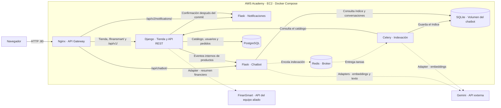

# Arquitectura de despliegue de Volt

La instancia EC2 de AWS Academy ejecuta los servicios de Volt con Docker Compose. Nginx recibe las peticiones en el puerto 80 y distribuye el tráfico. PostgreSQL, Redis y los puertos de aplicación se usan dentro de la red de Compose.

Django mantiene las operaciones de catálogo, carrito y pedidos. El patrón Strangler encamina las rutas de notificaciones y chatbot a sus servicios Flask. Nginx bloquea el acceso público a `/internal/`, que usa Django para comunicar cambios del catálogo al chatbot.

FinanSmart y Gemini requieren configuración en el entorno de ejecución. Para FinanSmart, configurar `FINANSMART_SUMMARY_URL` con una URL accesible desde EC2 y `FINANSMART_TOKEN` con un token de demostración, ya que la vista del resumen es pública. El modo `fake` muestra datos simulados. Para Gemini, configurar `GEMINI_API_KEY` y comprobar la indexación y una consulta desde el widget.
